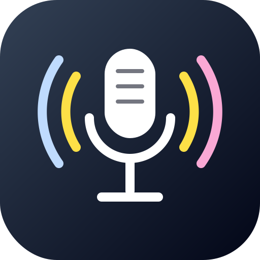
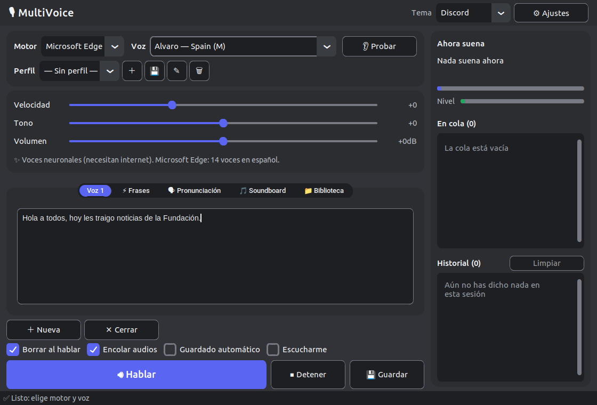
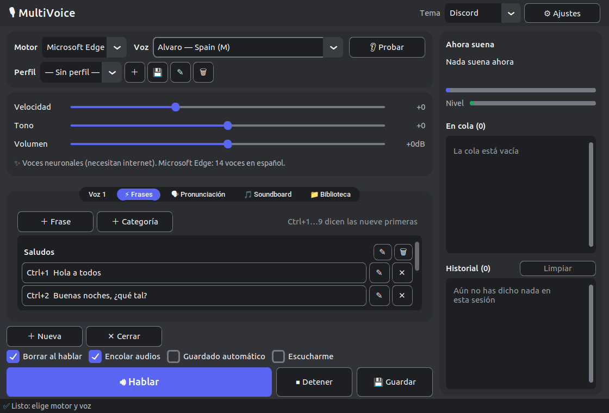
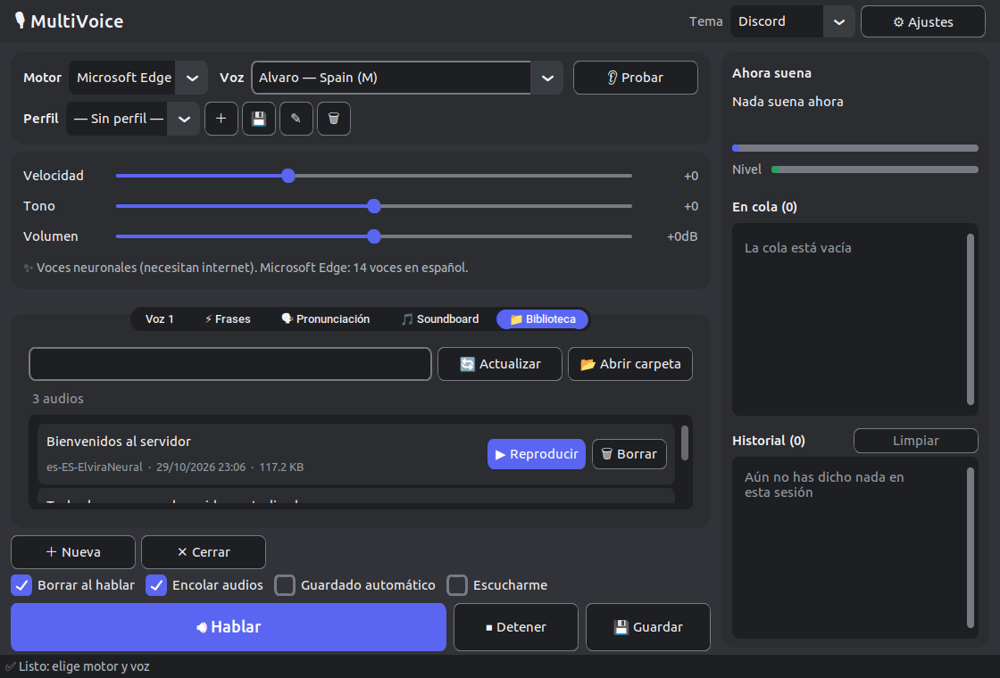
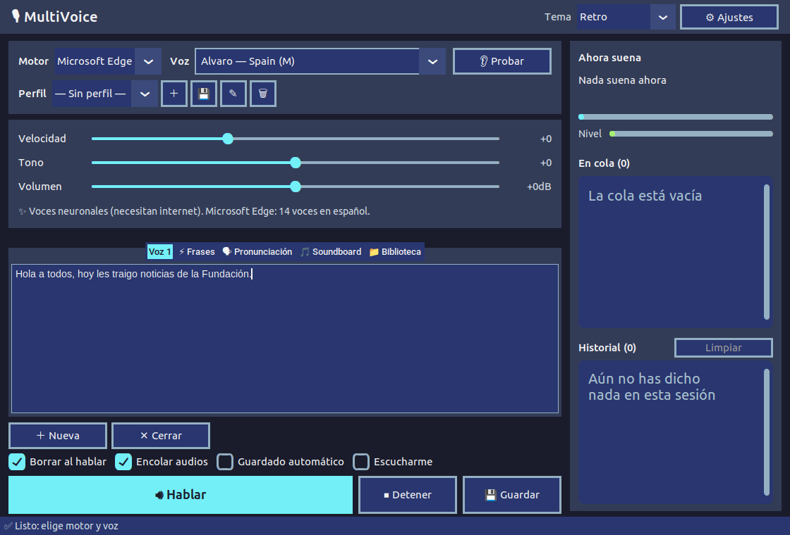
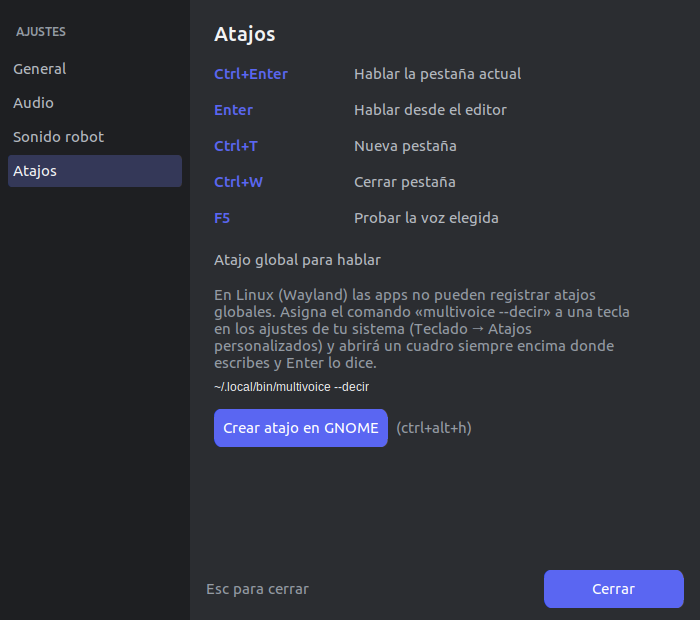

<div align="center">

[English](README.md) · **Español**



# MultiVoice

**Convierte texto en voz y habla por un micrófono virtual en Discord y otras apps**

Escribe en la ventana, pulsa **Hablar** y tu público te oye con la voz que elegiste.

**[⬇ Descarga la última versión](https://github.com/BenReynor/MultiVoice/releases/latest)** · Linux y Windows · sin instalación

</div>

> [!WARNING]
> **Windows es experimental y no se ha probado en un PC real.** MultiVoice se
> desarrolla y usa en Linux. En Windows la app se compila y su ventana se abre en
> las pruebas automáticas, pero la función principal, hablar en Discord a través
> del cable virtual **VB-CABLE**, nunca se ha probado en hardware real. En Windows
> debes instalar VB-CABLE tú mismo (ver [Micrófono virtual en Windows](#micrófono-virtual-en-windows)).
> Si falla, por favor [abre un issue](https://github.com/BenReynor/MultiVoice/issues).

## Capturas

| Ventana principal (tema Discord) | Frases rápidas |
|---|---|
|  |  |
| **Biblioteca de audios** | **Tema retro** (uno de 10) |
|  |  |

<p align="center"><br><em>Ajustes → Atajos, con el atajo global para hablar</em></p>

La interfaz está en **inglés por defecto**. Para cambiarla a español ve a **Settings → General → Language / Idioma**, elige *Español* y reinicia la app.

## Qué puedes hacer

- **Tres motores TTS:** voces neuronales de Microsoft Edge (14 voces en español, con internet), Google TTS (gTTS, con internet) y el **sonido robot** local (espeak-ng, sin internet) que imita a SCP-079, con control de metal (distorsión), velocidad, tono y volumen.
- **Perfiles de voz:** guarda motor, voz, velocidad, tono, volumen y metal con un nombre (p. ej. «SCP-079», «Narrador») y cambia entre ellos desde la barra de voz. Incluye dos perfiles de ejemplo.
- **Frases rápidas:** botones agrupados en categorías que dicen una frase con un clic, con el perfil activo o el suyo. Las nueve primeras están en **Ctrl+1 … Ctrl+9**.
- **Cola e historial:** un panel lateral muestra lo que suena (con barra de progreso y medidor de nivel), lo que espera en la cola (cada elemento se puede quitar) y lo que dijiste en esta sesión (repite con un clic).
- **Diccionario de pronunciación:** reemplazos aplicados antes de hablar con cualquier motor (p. ej. `xd` → «equis de»), por palabra completa o no, sin distinguir mayúsculas; se puede desactivar.
- **Soundboard:** añade tus propios archivos de audio (mp3/wav/ogg), ponles nombre y reprodúcelos por el micrófono virtual, respetando la cola.
- **Escucharte:** el interruptor **Escucharme** también reproduce por tus altavoces lo que sale por el micrófono virtual.
- **Atajo global para hablar desde cualquier app:** `multivoice --decir` abre una cajita siempre visible en la app en ejecución; escribe y pulsa Enter. Ver [Atajo global](#atajo-global).
- **Varias pestañas de texto**, borrado automático opcional tras hablar y **guardado de audio** en MP3 o WAV.
- **Biblioteca de audios:** con *Guardado automático* activado, cada texto hablado se guarda con su texto y su voz; busca, reproduce, abre la carpeta o borra. Los archivos creados por la app (`voz_*`) de más de 30 días se borran automáticamente; cualquier otro archivo de la carpeta nunca se toca.
- **10 temas** (Discord por defecto, minimal, cyberpunk, cálido, datos, anime, manga, glass, retro, brutalista), con variantes clara/oscura donde existen.
- **Instancia única:** abrirla de nuevo trae al frente la ventana abierta en vez de iniciar una segunda copia.

## Instalación

### Estado por plataforma

| Sistema | Estado |
|--------|--------|
| **Linux** | ✅ Desarrollado y probado aquí, incluido el audio real por el micrófono virtual. |
| **Windows** | 🧪 **Experimental, sin probar en un PC real.** Se compila y la ventana se abre en las pruebas automáticas, pero la reproducción por VB-CABLE no se ha probado en hardware real. `install.sh` y `start.sh` son solo para Linux: en Windows usa `multivoice.exe` o `python multivoice.py`. |

Las versiones para Windows se ofrecen en la medida de lo posible. Si algo falla ahí, por favor [abre un issue](https://github.com/BenReynor/MultiVoice/issues) con tu versión del sistema y lo que viste.

### Opción 1: binario ya compilado (Linux y Windows)

Descarga el archivo de tu sistema desde [Releases](https://github.com/BenReynor/MultiVoice/releases), descomprímelo y ábrelo. Hay un `.zip` por sistema:

- `multivoice-linux-x86_64.zip` → Linux en procesadores Intel/AMD (el más común)
- `multivoice-linux-arm64.zip` → Linux en ARM (Raspberry Pi, muchas placas ARM)
- `multivoice-windows-x64.zip` → Windows

No se instala nada ni se crean accesos directos: el ejecutable funciona desde donde lo descomprimas.

- **Linux:** hazlo ejecutable y lánzalo. Solo necesita `pactl`/`pw-play` (PipeWire) para crear el micrófono virtual; `ffmpeg` y `espeak-ng` ya van incluidos.
  ```bash
  chmod +x multivoice && ./multivoice
  ```
- **Windows:** ejecútalo; si SmartScreen muestra «Windows protegió su PC», elige *Más información → Ejecutar de todas formas* (el ejecutable no está firmado).

El binario incluye Python, las librerías de voz, `ffmpeg` y `espeak-ng`. No incluye el cable de audio virtual para Windows, que debe instalarse aparte (ver abajo).

Cada push a `main` también compila binarios nuevos en GitHub Actions (workflow **Build**, artefactos por sistema), por si quieres la última versión antes de una release.

### Opción 2: desde el código fuente (Linux)

Requiere Python 3.8+ con Tk y los paquetes del sistema `ffmpeg` y `espeak-ng`. En Debian/Ubuntu:

```bash
sudo apt install ffmpeg espeak-ng python3-tk
git clone https://github.com/BenReynor/MultiVoice.git
cd MultiVoice
./install.sh     # lanzador en el menú de aplicaciones y en el escritorio
./start.sh       # o ábrelo desde el lanzador
```

`start.sh` crea el `.venv` propio del proyecto la primera vez (con [uv](https://docs.astral.sh/uv/) si está instalado, si no `venv` + `pip`) e instala `requirements.txt`; lo vuelve a sincronizar cada vez que `requirements.txt` cambia, mostrando una ventana de progreso mientras tanto. El lanzador creado por `install.sh` encuentra la carpeta aunque la muevas dentro de tu home, y su icono se actualiza junto con la app.

En Windows desde el código fuente: `python -m pip install -r requirements.txt` y `python multivoice.py`.

## Inicio rápido

En Linux la app crea el micrófono virtual `🎤` al abrirse y lo quita al cerrarse. En la app donde quieras hablar, selecciónalo como dispositivo de entrada:

- Discord: Ajustes → Voz y vídeo → Dispositivo de entrada → `🎤`
- Cualquier otra app que permita elegir micrófono funciona igual.

Escribe un texto, pulsa **🔊 Hablar** (o Enter) y la voz sale por el micrófono virtual.

## Atajo global

`multivoice --decir` pide a la MultiVoice abierta que muestre una cajita siempre visible: escribe, pulsa Enter y se dice. Para usarlo desde cualquier app, asígnalo a una tecla:

- **Linux:** Wayland no permite que las apps registren atajos globales, así que lo hace el sistema. *Ajustes → Atajos* muestra el comando exacto y, en GNOME, un botón que crea el atajo por ti (por defecto `Ctrl+Alt+H`). En otros escritorios, añade un atajo personalizado que ejecute ese comando.
- **Windows:** la app registra el atajo ella misma (configurable en *Ajustes → Atajos*, por defecto `Ctrl+Alt+H`).

## Atajos de teclado

| Atajo | Acción |
|----------|--------|
| Enter / Ctrl+Enter | Hablar la pestaña actual |
| Ctrl+T | Nueva pestaña |
| Ctrl+W | Cerrar pestaña |
| Ctrl+1 … Ctrl+9 | Decir la frase rápida 1–9 |
| F5 | Probar la voz seleccionada |
| Esc | Cerrar Ajustes y diálogos |

## Micrófono virtual en Windows

Ahí la app no puede crear el micrófono por sí sola: necesita un cable de audio virtual del sistema. La app lo detecta y reproduce por él automáticamente; solo tienes que seleccionar la entrada en Discord.

1. **Instala el cable (una vez):** [VB-CABLE](https://vb-audio.com/Cable/) (instalador, requiere permisos de administrador).
2. **Elige la entrada en Discord:** Ajustes → Voz y vídeo → Dispositivo de entrada → `CABLE Output`.

Para escucharte, activa **Escucharme** en la app (también reproduce por tu salida normal).

### Si algo no suena bien

- Deja la app abierta; solo reproduce mientras se ejecuta.
- Si Discord suena muy bajo, prueba *Discord → Ajustes → Voz y vídeo → Desactivar el procesamiento de audio* y ajusta el volumen de entrada.
- Si no detecta el cable, la app reproduce por los altavoces y te avisa al abrirse.

## Notas

- El micrófono virtual `🎤` solo existe en Linux y mientras la app está abierta.
- Edge TTS y Google TTS necesitan internet. El robot funciona sin conexión y usa `espeak-ng`; va incluido en los binarios (desde el código fuente debes tenerlo instalado).
- **Privacidad:** con Edge TTS y Google TTS el texto que escribes se envía a Microsoft y a Google respectivamente. El sonido robot es totalmente local. Con el guardado automático, el texto también se guarda en texto plano junto a cada archivo de audio.
- **Dónde se guarda todo:** la biblioteca de audios va a `~/MultiVoice_Audio` (Linux) o `Documents/MultiVoice_Audio` (Windows). Los ajustes, perfiles, frases rápidas, el diccionario y la lista del soundboard se guardan en `config.json`: en tu carpeta de configuración de usuario para la app empaquetada (`~/.config/MultiVoice` o `%APPDATA%\MultiVoice`), junto a `multivoice.py` si se ejecuta desde el código fuente.

## Desarrollo

```bash
.venv/bin/ruff check .
.venv/bin/python -m pytest -q
.venv/bin/python tests/smoke_test.py            # motores TTS (sin red)
xvfb-run -a .venv/bin/python tests/gui_smoke.py # abre la ventana real sin pantalla
```

CI ejecuta las mismas comprobaciones en Linux y Windows y compila los binarios (`.github/workflows/build.yml`). Las compilaciones empaquetadas incluyen los archivos de datos de CustomTkinter (`--collect-all customtkinter`), los temas (`--add-data assets/temas`) y el icono; si añades una dependencia con archivos de datos o una carpeta que se lea en ejecución, añádela también al paso «Build executable». `CONTEXTO.md` explica la estructura y las decisiones de diseño.

## Contribuir

Las contribuciones son bienvenidas: abre un [issue](https://github.com/BenReynor/MultiVoice/issues)
para informar de un error o proponer una idea, o envía un pull request. Ejecuta antes las
comprobaciones de [Desarrollo](#desarrollo) (CI las ejecuta en Linux y Windows). Probar en
un PC Windows real con VB-CABLE es especialmente útil. La interfaz está en inglés (con español opcional).

## Licencia

[MIT](LICENSE): puedes usar, copiar, modificar y distribuir MultiVoice libremente, incluso
en tus propios proyectos, siempre que conserves el aviso de copyright.
